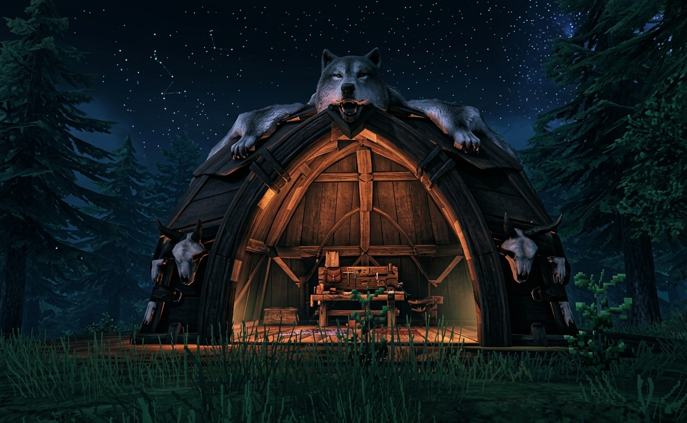
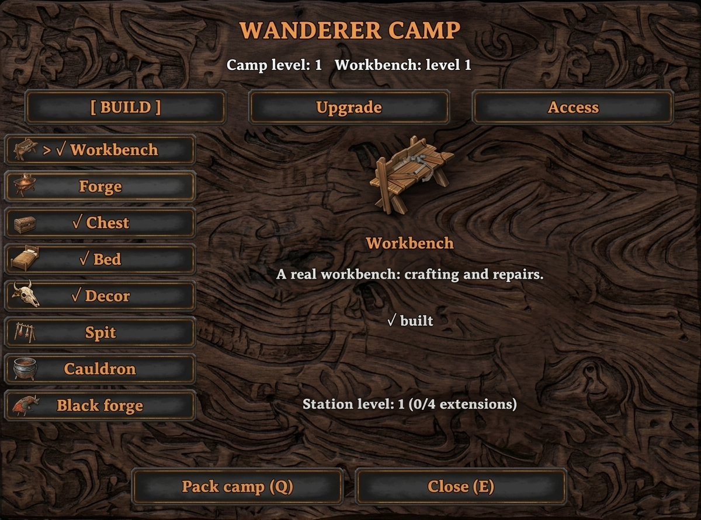
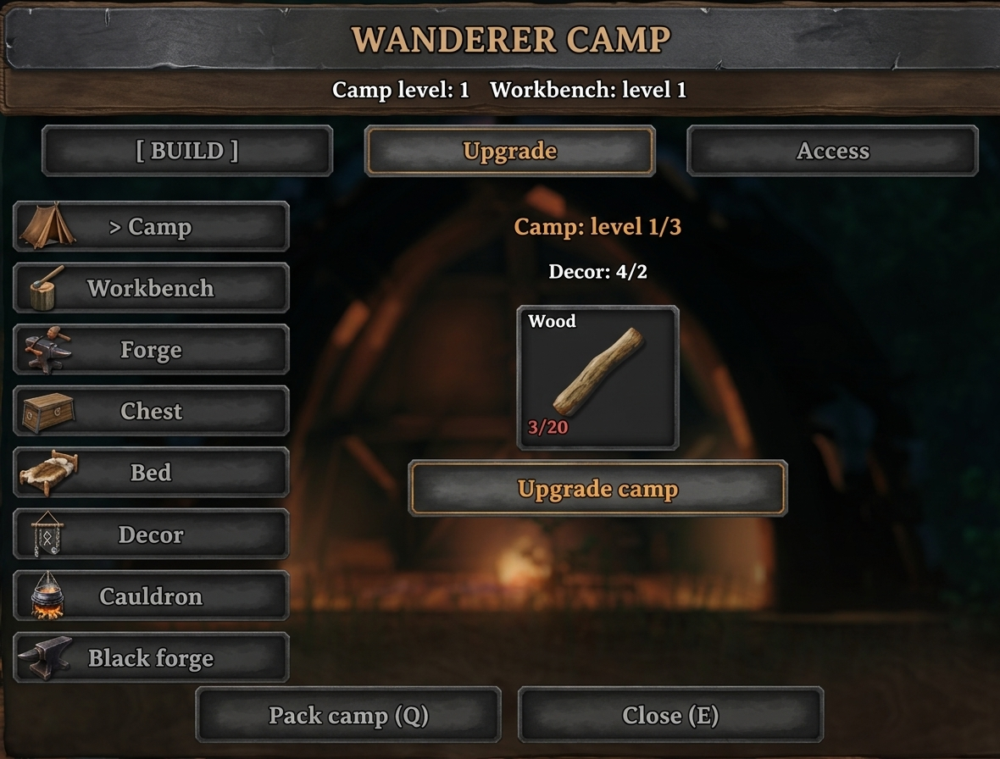
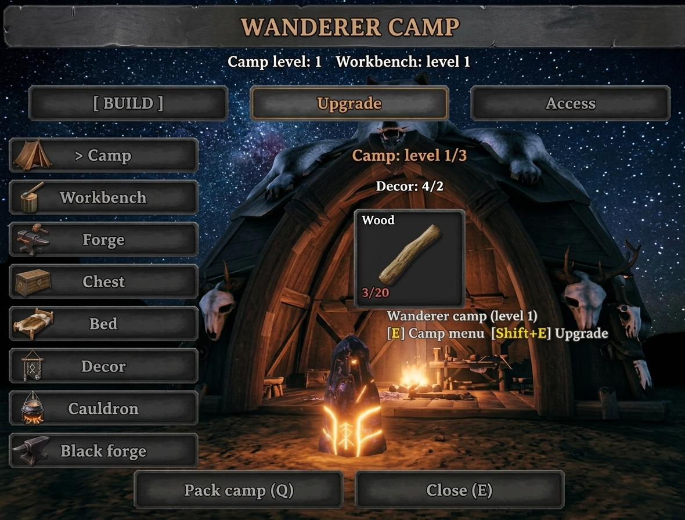

# vl — Wanderer's Shelter screenshots

Image host for Thunderstore `README.md`. Order = Thunderstore top gallery 1-2-3-4.

Raw links used by the mod package:
- https://raw.githubusercontent.com/global000011-lgtm/vl/main/docs/images/1.jpg
- https://raw.githubusercontent.com/global000011-lgtm/vl/main/docs/images/2.jpg
- https://raw.githubusercontent.com/global000011-lgtm/vl/main/docs/images/3.jpg
- https://raw.githubusercontent.com/global000011-lgtm/vl/main/docs/images/4.jpg
